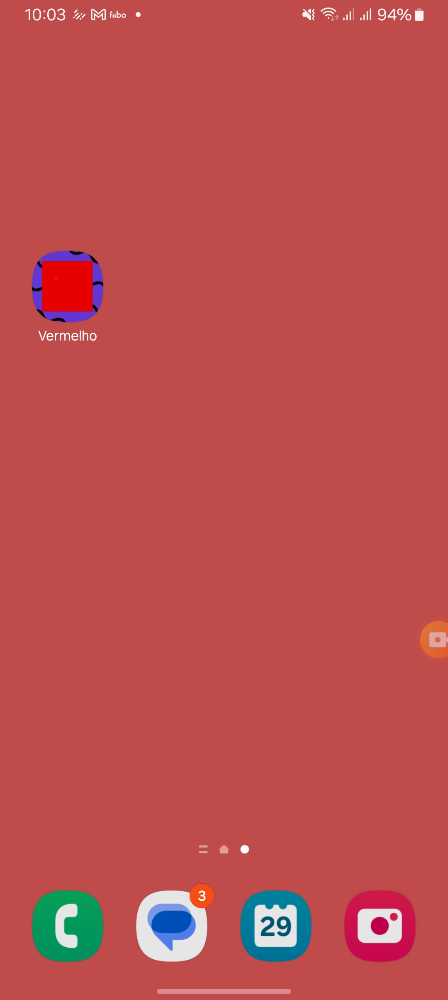
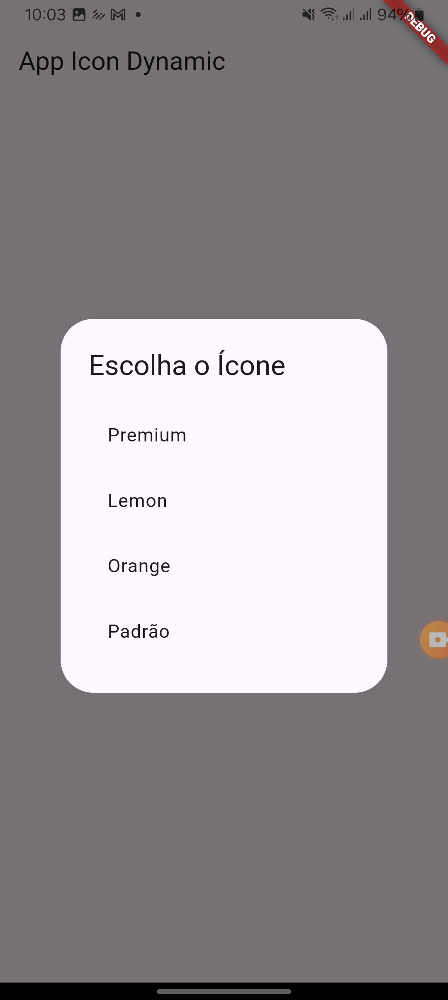
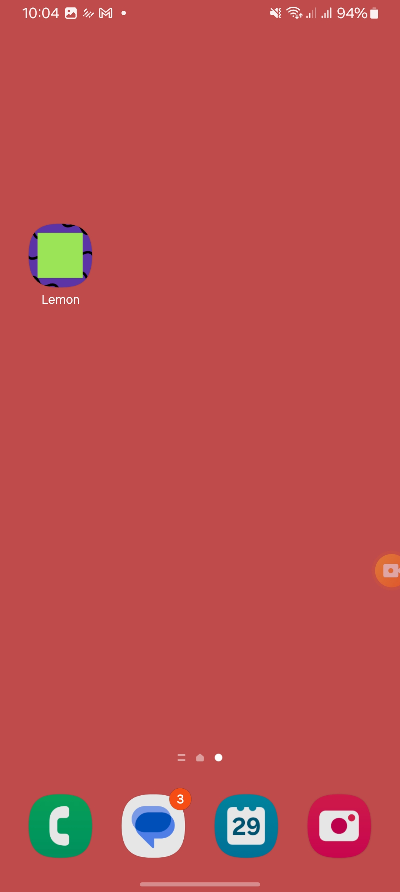
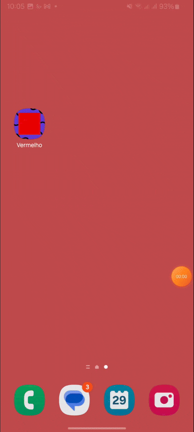

# 📱 Ícone Dinâmico no Flutter / Dynamic App Icon in Flutter


Este projeto implementa a **mudança dinâmica de ícone e splash screen** no Flutter, sem necessidade de novo build ou release. O usuário escolhe um ícone dentro do app; a escolha é persistida e aplicada na próxima abertura. Projetado para funcionar em apps com **múltiplos flavors** (whitelabel).

This project implements **runtime app icon and splash screen switching** in Flutter, with no rebuild or new release required. The user selects an icon inside the app; the choice is persisted and applied on the next launch. Designed to work in **multi-flavor whitelabel apps**.

---

## ✨ Funcionalidades / Features

| Feature | Android | iOS |
|---|:---:|:---:|
| Troca de ícone / Icon change | ✅ | ✅ |
| Troca de label do app / App label change | ✅ | — |
| Troca de splash screen / Splash screen change | ✅ | ✅ |
| Persistência da seleção / Selection persistence | ✅ | ✅ |
| Separação por flavor/schema / Flavor support | ✅ | ✅ |

---

## 📱 Demonstração / Demo

| Selecionando um ícone / Selecting an icon | Reiniciando o app / Restarting the app | Novo ícone aplicado / New icon applied |
|:---:|:---:|:---:|
|  |  |  |



---

## ⚙️ Como funciona / How it works

**Android** — A troca usa `activity-alias` no `AndroidManifest.xml`. Cada alias representa um ícone alternativo. O `PackageManager` habilita/desabilita os aliases em runtime; o app precisa ser reiniciado para a mudança aparecer no launcher.

**iOS** — Suportado nativamente desde iOS 10.3 via `CFBundleAlternateIcons` no `Info.plist`. A troca acontece via API do sistema, sem reinício obrigatório.

**EN** — On Android, icon switching relies on `activity-alias` entries toggled via `PackageManager`. On iOS, alternate icons are declared in `Info.plist` and switched through the native API, available since iOS 10.3.

---

## 📦 Dependências / Dependencies

```yaml
dependencies:
  flutter_dynamic_icon_plus: ^1.3.0
```

---

## 🛠 Instalação / Setup

```bash
git clone https://github.com/macielalex/dynamic_app_icon.git
cd dynamic_app_icon
flutter pub get
```

---

## ⚙️ Configuração Android / Android Setup

### Ativar aliases no `AndroidManifest.xml`

```xml
<activity-alias
    android:name=".PremiumActivity"
    android:label="App Premium"
    android:enabled="false"
    android:exported="true"
    android:icon="@mipmap/ic_launcher_premium"
    android:targetActivity=".MainActivity">
    <intent-filter>
        <action android:name="android.intent.action.MAIN" />
        <category android:name="android.intent.category.LAUNCHER" />
    </intent-filter>
</activity-alias>
```

### Permissão necessária / Required permission

```xml
<uses-permission android:name="android.permission.CHANGE_COMPONENT_ENABLED_STATE" />
```

### Configurar flavors (opcional) / Configure flavors (optional)

```groovy
android {
    flavorDimensions "env"
    productFlavors {
        base {
            dimension "env"
            applicationIdSuffix ".base"
        }
        premium {
            dimension "env"
            applicationIdSuffix ".premium"
        }
    }
}
```

---

## 🍏 Configuração iOS / iOS Setup

### Declarar ícones alternativos no `Info.plist`

```xml
<key>CFBundleAlternateIcons</key>
<dict>
    <key>PremiumIcon</key>
    <dict>
        <key>CFBundleIconFiles</key>
        <array>
            <string>PremiumIcon</string>
        </array>
    </dict>
    <key>LemonIcon</key>
    <dict>
        <key>CFBundleIconFiles</key>
        <array>
            <string>LemonIcon</string>
        </array>
    </dict>
</dict>
```

---

## 🚀 Rodando o app / Running the app

```bash
# Android
flutter run --flavor premium

# iOS
flutter run --flavor premium --target=lib/main_premium.dart
```

---

## 📜 Licença / License

MIT — veja [LICENSE](LICENSE) para detalhes / see [LICENSE](LICENSE) for details.

---

## 📬 Contato / Contact

Dúvidas ou sugestões? Entre em contato! / Questions or suggestions? Get in touch!

📧 [alexmaciel.mail@gmail.com](mailto:alexmaciel.mail@gmail.com)  
💼 [linkedin.com/in/alex-maciel-867b8933](https://www.linkedin.com/in/alex-maciel-867b8933/)
